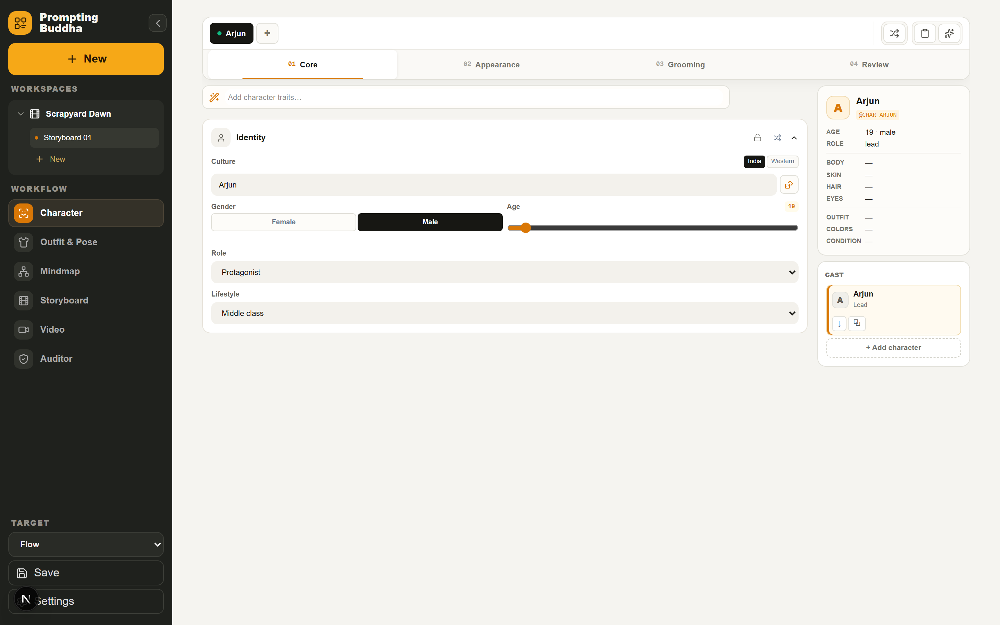
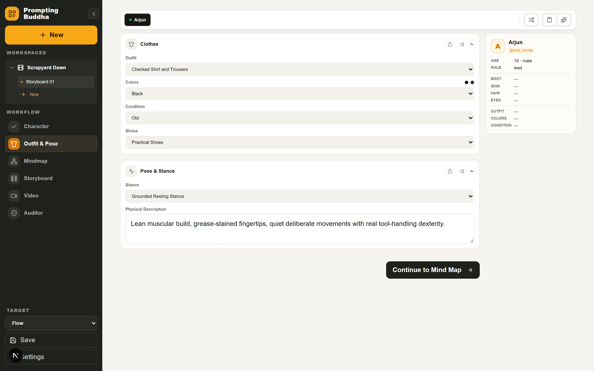
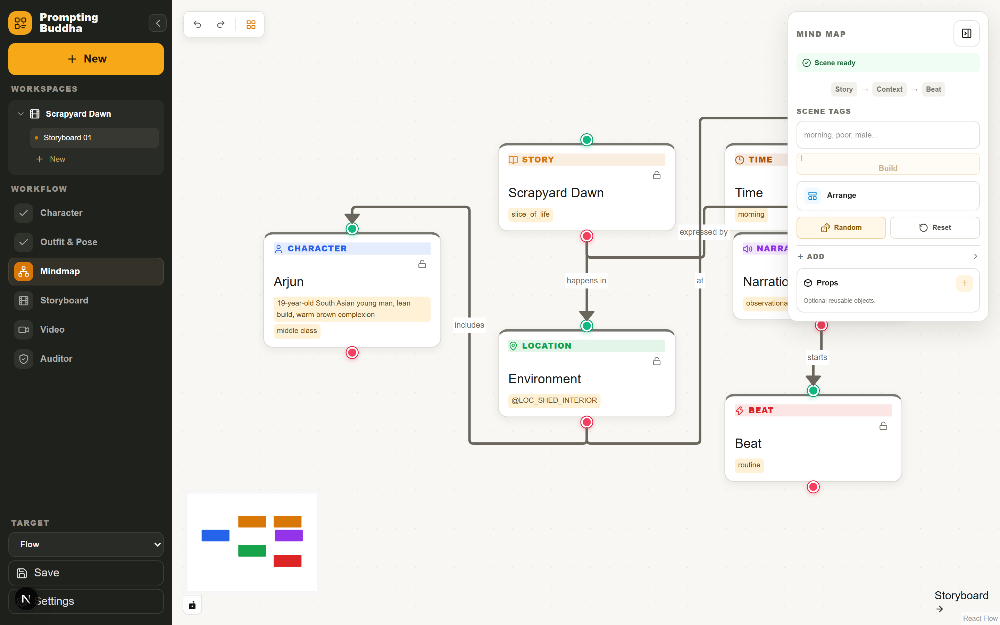
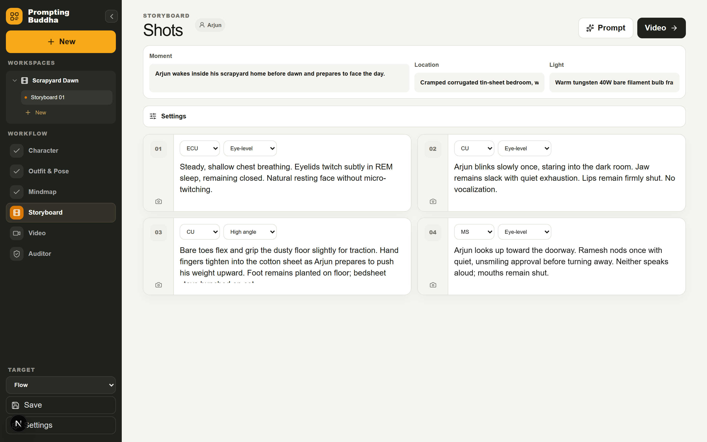
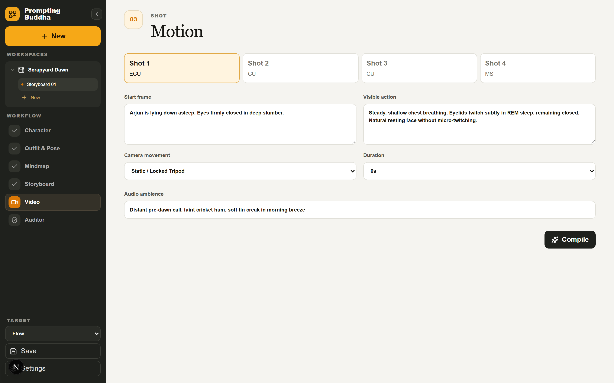
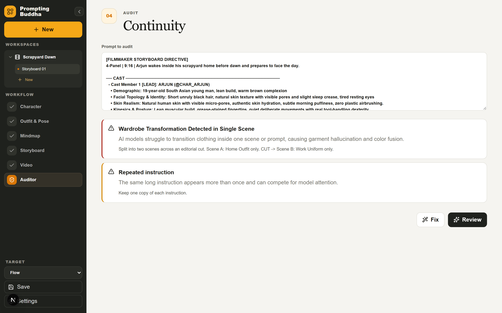
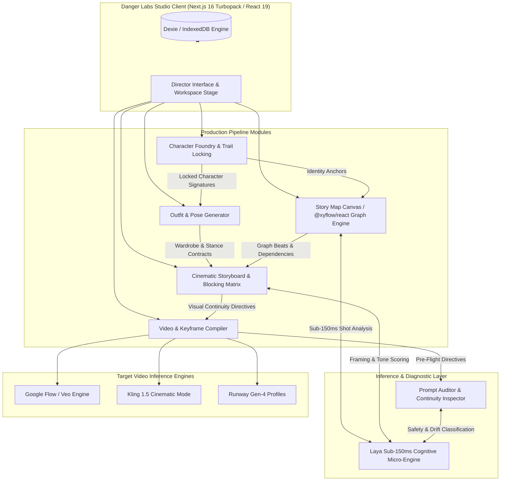

<div align="center">

<svg width="120" height="120" viewBox="0 0 40 40" fill="none" xmlns="http://www.w3.org/2000/svg">
  <rect width="40" height="40" rx="10" fill="#090A0F" stroke="#27272A" stroke-width="1.5"/>
  <rect x="7" y="7" width="10" height="10" rx="2" fill="#D97706" fill-opacity="0.9" stroke="#F59E0B" stroke-width="1"/>
  <rect x="23" y="7" width="10" height="10" rx="2" fill="#18181B" stroke="#3F3F46" stroke-width="1"/>
  <rect x="7" y="23" width="10" height="10" rx="2" fill="#18181B" stroke="#3F3F46" stroke-width="1"/>
  <rect x="23" y="23" width="10" height="10" rx="2" fill="#D97706" fill-opacity="0.3" stroke="#F59E0B" stroke-width="1"/>
  <circle cx="20" cy="20" r="3.5" fill="#FBBF24"/>
  <line x1="17" y1="12" x2="23" y2="12" stroke="#71717A" stroke-width="1.2" stroke-linecap="round"/>
  <line x1="12" y1="17" x2="12" y2="23" stroke="#71717A" stroke-width="1.2" stroke-linecap="round"/>
  <line x1="28" y1="17" x2="28" y2="23" stroke="#71717A" stroke-width="1.2" stroke-linecap="round"/>
  <line x1="17" y1="28" x2="23" y2="28" stroke="#71717A" stroke-width="1.2" stroke-linecap="round"/>
</svg>

# PROMPTING BUDDHA
### Developed & Maintained by DANGER LABS
**Enterprise Cognitive Engine & Visual Continuity Studio for Generative Cinema**

[](https://github.com/dr-week/Prompting-Buddha)
[](https://github.com/dr-week/Prompting-Buddha)
[-black?style=for-the-badge&logo=next.js&logoColor=white)](https://nextjs.org/)
[](https://react.dev/)
[](https://www.typescriptlang.org/)
[](https://vitest.dev/)
[](https://oxc-project.github.io/)
[](LICENSE)

<p align="center">
  <b>A deterministic visual orchestration platform designed for generative film directors, animators, and digital artists.</b><br/>
  Engineered by <b>DANGER LABS</b> to eliminate cross-scene hallucinations, identity drifts, and narrative disconnections across Google Flow, Veo, Kling, and Runway Gen-4.
</p>

[Live Interface Tour](#live-interface-tour) •
[System Architecture](#system-architecture) •
[Production Pipeline](#production-pipeline) •
[Optimal Concise Compiler](#optimal-concise-prompt-compiler) •
[Laya Cognitive Engine](#laya-cognitive-engine) •
[Getting Started](#getting-started) •
[Quality Verification](#quality-verification)

</div>

---

## Live Interface Tour

*High-resolution production captures directly recorded from the running Danger Labs application:*

### 01. Character Foundry
> *Isolated character casting, physical topology, facial geometry, ethnicity, and granular feature locking.*
<div align="center">
  
</div>

<br/>

### 02. Outfit & Pose Generator
> *Dedicated module for authentic lived-in textiles, culturally-grounded wardrobes, footwear, and physical kinesics/stance (T=0).*
<div align="center">
  
</div>

<br/>

### 03. Story Map (Graph Mind Canvas)
> *Directed graph narrative canvas (`@xyflow/react`) linking Premise, Cast, Environment, Props, and Beats with instant branch variations.*
<div align="center">
  
</div>

<br/>

### 04. Cinematic Storyboard
> *Shot framing (`ECU`, `CU`, `MCU`, `MS`, `WS`, `OTS`, `POV`), camera movement, and continuous timeline propagation.*
<div align="center">
  
</div>

<br/>

### 05. Video Keyframe Compiler
> *Shot-by-shot video generation directives (`Ingredients Mode` & `Start Frame Mode`) with anti-collision physical guardrails.*
<div align="center">
  
</div>

<br/>

### 06. Continuity Auditor
> *Real-time diagnostic inspector that catches mid-scene costume swaps, attention competition, and unanchored subject identities.*
<div align="center">
  
</div>

---

## Executive Summary

Generative diffusion and video models suffer from inherent stochastic degradation across multi-scene storylines: character features mutate, wardrobe shifts without narrative justification, camera framing drifts, and background objects hallucinate unnatural physical collisions.

**Prompting Buddha**, built by **DANGER LABS**, delivers an enterprise-grade studio environment founded on strict mathematical continuity contracts:
1. **Isolated Character Identity**: Character features (Face, Hair, Skin, Demeanor) are engineered in a dedicated Character module.
2. **Dedicated Outfit & Pose Generator**: Garments, footwear wear, posture, and spatial resting stance are managed independently so character identity remains pure and unpolluted.
3. **Optimal, Short, and Precise Prompts**: Replaced bloated, noisy prompt templates with razor-sharp directives that maximize modern diffusion attention weights and eliminate token hallucination.
4. **Laya System-1 Micro-Engine**: Sub-150ms cognitive decision layer that validates framing, safety, and narrative tone without slowing down the director.

---

## System Architecture



---

## Production Pipeline

### 1. Character Foundry
- **Clean Biological Architecture**: Focuses strictly on physical features: Face, Hair, Eyes, Tone, Demeanor, and Age/Gender demographics.
- **Granular Locking Matrix**: Lock `Identity`, `Body`, `Hair`, `Face`, and `Skin` independently to preserve exact likeness across rolls.
- **Cast Management**: Support for primary protagonists, secondary deuteragonists, and scene-specific tertiary characters with guaranteed separation of visual tokens.

### 2. Outfit & Pose Generator
- **Independent Wardrobe Studio**: Select authentic daily wear, work garments, or festive attire with lived-in fabric textures, palettes, and footwear.
- **Physical Stance & Kinesics (T=0)**: Establish resting centers of gravity, muscle tension, and posture anchors that prevent video models from animating backward.
- **Orthogonal Lock Contracts**: Independent `Wardrobe`, `Footwear`, and `Pose` locking prevents costume overrides during prompt iterations.

### 3. Story Map (Graph Mind Canvas)
- **Visual Narrative Flow**: Built on `@xyflow/react`, allowing non-linear graph modeling of cinematic premises, environments, character interactions, narrative beats, and dialogue moments.
- **Category Locking on Canvas**: Lock beats, locations, or props directly on canvas to preserve structural milestones during layout auto-arrangement.
- **Seed Variations**: Generate instant narrative branch variations with reproducible pseudorandom seeds.

### 4. Cinematic Storyboard
- **Cinematic Framing Profiles**: First-class camera distance support (`ECU`, `CU`, `MCU`, `MS`, `WS`, `OTS`, `POV`).
- **Spatial Positioning**: Deterministic character blocking relative to the camera lens and environmental reference anchors.
- **Continuous Timeline Propagation**: Character trait changes immediately update down-pipeline storyboard boards and scripts.

### 5. Video & Keyframe Compiler
- **Dual-Mode Generation Architecture**:
  - `Ingredients Mode`: Discrete character, environmental, and motion prompt assets.
  - `Start Frame Mode`: Direct video interpolation from generated master keyframes.
- **Physical Plausibility Injectors**: Anti-hallucination guardrails (e.g., thermal insulation for high-temperature items, zero-velocity initial pose anchors, anti-collision bounding).

### 6. Prompt Auditor & Diagnostic Inspector
- **Static Token Inspection**: Flags mid-scene costume mutations, attention competition, contradictory lighting directions, and token overcrowding.
- **Direct Fix Synthesizer**: Replaces ambiguous phrasing ("the person") with locked character aliases with one-click resolution.

---

## Optimal, Concise Prompt Compiler

> *"Big, noisy prompts dilute diffusion attention heads and cause model hallucinations. Concise, precise prompts yield superior visual fidelity."*  
> — **Danger Labs Generative Research**

The studio compiler has been re-architected to remove verbose metadata, token clutter, and unneeded explanations. Compare the precision:

```
[CONCISE PROMPT ARCHITECTURE]
3-view character turnaround reference sheet of ARJUN (@CHAR_ARJUN)

CHARACTER IDENTITY & PHYSIQUE:
- Subject: Arjun, 19-year-old South Asian young man, lean build.
- Facial Features: Short unruly black hair, natural skin texture with visible pores.
- Hair & Eyes: Black messy hair, warm brown eyes.
- Skin & Tone: Natural skin tone with authentic micro-texture.
- Demeanor: Restrained, watchful resting expression; quiet internal life.

TURNAROUND COMPOSITION:
3-view studio character turnaround (front portrait, 45-degree angle, full side profile), seamless neutral grey studio backdrop, crisp 35mm portrait lighting, 8k photographic sharpness.
```

---

## Laya Cognitive Engine

**Laya** is Danger Labs' **sub-150ms System-1 cognitive micro-inference engine** engineered into the studio runtime. It operates as an asynchronous, non-blocking intelligence tier providing instant feedback on narrative and framing decisions.

```
                    ┌────────────────────────┐
                    │      Text Input        │
                    └───────────┬────────────┘
                                │
                    ┌───────────▼────────────┐
             ───────►   In-Memory LRU Cache  ├─────── Hit (0ms) ──► Return
            │       │   (Max 500 records)    │
            │       └───────────┬────────────┘
            │                   │ Miss
            │       ┌───────────▼────────────┐
            │       │  predictLaya(text)     │
            │       │  AbortController (150ms│
            │       └───────────┬────────────┘
            │                   │
            │       ┌───────────▼────────────┐
            └───────┤ Cache & Schema Validate│ ─── Valid ─────────► Return
                    └───────────┬────────────┘
                                │ Timeout / Malformed
                    ┌───────────▼────────────┐
                    │   Safe Fallback (null) │
                    └────────────────────────┘
```

### Integrated Cognitive Schemas
- **`SHOT_FRAMING_SCHEMA`**: Evaluates scene prose to dynamically determine camera distance and angle.
- **`PROMPT_AUDIT_SCHEMA`**: Identifies attention token competition, unanchored identities, and costume discontinuities.
- **`STORY_TONE_SCHEMA`**: Classifies narrative tension and pacing between contemplative slice-of-life and high-octane cinematic beats.

---

## Tech Stack

| Domain | Technology | Rationale |
| :--- | :--- | :--- |
| **Framework** | **Next.js 16.3.5 (App Router)** | High-performance server rendering with next-generation Turbopack build engine. |
| **Runtime** | **React 19 & TypeScript 5** | Concurrent rendering, strict type-soundness, and modern action hooks. |
| **Styling** | **Tailwind CSS 4** | Ultra-lean CSS footprint, modern styling variables, dark cinematic palette. |
| **Canvas** | **@xyflow/react** | Production-proven directed graph visualization and node orchestration. |
| **Client Storage** | **Dexie (IndexedDB)** | Schema-versioned offline storage with zero network dependencies. |
| **Testing** | **Vitest & Playwright** | Fast unit/integration coverage (96 tests) and end-to-end browser verification. |
| **Linting** | **Oxlint & ESLint 9** | High-velocity Rust-based linting alongside ECMAScript conformance rules. |

---

## Getting Started

### Prerequisites
- **Node.js**: `v20.0.0` or higher
- **npm**: `v10.0.0` or higher

### Installation
```bash
# Clone the official repository
git clone https://github.com/dr-week/Prompting-Buddha.git

# Navigate to project root
cd Prompting-Buddha

# Install production and development dependencies
npm install
```

### Development Server
```bash
# Launch Next.js dev server with Turbopack
npm run dev

# Or launch on an explicit custom port
npx next dev -p 3001
```
Open [http://localhost:3000](http://localhost:3000) (or `http://localhost:3001`) in your browser.

---

## Quality Verification

Danger Labs enforces rigorous pre-commit validation:

```bash
# 1. Run ultra-fast Rust-based static linting (0 errors, 0 warnings)
npm run lint:oxlint

# 2. Run the Vitest unit and integration suite (96 passing tests)
npm test

# 3. Execute Next.js Turbopack production build verification
npm run build
```

---

## Security & Local-First Architecture

Prompting Buddha operates on a strict **Local-First Architecture**. All workspaces, character specifications, plot graphs, and prompt blueprints are stored directly in your browser's client-side IndexedDB storage via Dexie. No project data or proprietary storylines are transmitted to third-party tracking services.

---

## License

This project is licensed under the **MIT License** — see the [LICENSE](LICENSE) file for details.

<div align="center">
  <br/>
  <sub>Developed and maintained with precision by <b>DANGER LABS</b></sub><br/>
  <sub>© Prompting Buddha Contributors & DANGER LABS</sub>
</div>
