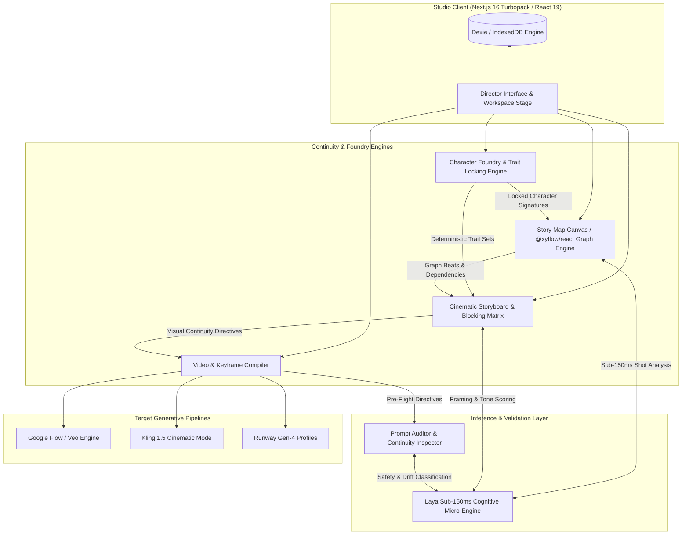

<div align="center">

<svg width="120" height="120" viewBox="0 0 40 40" fill="none" xmlns="http://www.w3.org/2000/svg">
  <rect width="40" height="40" rx="10" fill="#090A0F" stroke="#27272A" stroke-width="1.5"/>
  <rect x="7" y="7" width="10" height="10" rx="2" fill="#D97706" fill-opacity="0.9" stroke="#F59E0B" stroke-width="1"/>
  <rect x="23" y="7" width="10" height="10" rx="2" fill="#18181B" stroke="#3F3F46" stroke-width="1"/>
  <rect x="7" y="23" width="10" height="10" rx="2" fill="#18181B" stroke="#3F3F46" stroke-width="1"/>
  <rect x="23" y="23" width="10" height="10" rx="2" fill="#D97706" fill-opacity="0.3" stroke="#F59E0B" stroke-width="1"/>
  <circle cx="20" cy="20" r="3.5" fill="#FBBF24"/>
  <line x1="17" y1="12" x2="23" y2="12" stroke="#71717A" stroke-width="1.2" stroke-linecap="round"/>
  <line x1="12" y1="17" x2="12" y2="23" stroke="#71717A" stroke-width="1.2" stroke-linecap="round"/>
  <line x1="28" y1="17" x2="28" y2="23" stroke="#71717A" stroke-width="1.2" stroke-linecap="round"/>
  <line x1="17" y1="28" x2="23" y2="28" stroke="#71717A" stroke-width="1.2" stroke-linecap="round"/>
</svg>

# PROMPTING BUDDHA
### Enterprise Cognitive Engine & Visual Continuity Studio for Generative Cinema

[](https://github.com/dr-week/Prompting-Buddha)
[-black?style=for-the-badge&logo=next.js&logoColor=white)](https://nextjs.org/)
[](https://react.dev/)
[](https://www.typescriptlang.org/)
[](https://vitest.dev/)
[](https://oxc-project.github.io/)
[](LICENSE)

<p align="center">
  <b>A deterministic visual orchestration platform designed for generative film directors, animators, and digital artists.</b><br/>
  Eliminating cross-scene hallucinations, identity drifts, and narrative disconnections across Google Flow, Veo, Kling, and Runway Gen-4.
</p>

[System Architecture](#system-architecture) •
[Core Modules](#core-modules) •
[Laya Cognitive Engine](#laya-cognitive-engine) •
[Getting Started](#getting-started) •
[Verification & Quality Gates](#verification--quality-gates) •
[Documentation](#documentation)

</div>

---

## Executive Summary

Generative diffusion and video models suffer from inherent stochastic degradation across multi-scene storylines: character features mutate, wardrobe shifts without narrative justification, camera framing drifts, and background objects hallucinate unnatural physical collisions.

**Prompting Buddha** delivers an enterprise-grade studio environment built on strict continuity contracts. By combining a graph-based narrative canvas, multi-category trait lock engines, and the ultra-low latency **Laya System-1 Cognitive Engine**, creators can model complex cinematic stories with mathematical determinism and cross-scene visual consistency.

---

## System Architecture



---

## Core Modules

### 1. Character Foundry & Identity Locking Engine
- **Procedural Casting**: Generate culturally and socioeconomically authentic characters across global demographics.
- **Multi-Category Locking Contract**: Granularly lock and unlock attributes across 6 orthogonal dimensions:
  - `Identity` (Demographics, Archetype, Core Name)
  - `Body` (Stature, Build, Posture, Proportions)
  - `Hair` (Texture, Cut, Color, Styling)
  - `Face` (Bone structure, Features, Tone)
  - `Grooming` (Facial hair, Maintenance, Polish)
  - `Wardrobe` (Fabrics, Garments, Palette, Wear)
- **Mononym Cast Management**: Support for primary protagonists, secondary deuteragonists, and scene-specific tertiary characters with guaranteed separation of visual tokens.

### 2. Story Map (Graph Mind Canvas)
- **Visual Narrative Flow**: Built on `@xyflow/react`, allowing non-linear graph modeling of cinematic premises, environments, character interactions, narrative beats, and dialogue moments.
- **Category Locking on Canvas**: Lock beats, locations, or props directly on canvas to preserve structural milestones during layout auto-arrangement.
- **Seed Variations**: Generate instant narrative branch variations with reproducible pseudorandom seeds.

### 3. Storyboard & Shot Blocking Matrix
- **Cinematic Framing Profiles**: First-class camera distance support (`ECU`, `CU`, `MCU`, `MS`, `WS`, `OTS`, `POV`).
- **Spatial Positioning**: Deterministic character blocking relative to the camera lens and environmental reference anchors.
- **Continuous Timeline Propagation**: Character trait changes immediately update down-pipeline storyboard boards and scripts.

### 4. Video & Keyframe Compiler
- **Dual-Mode Generation Architecture**:
  - `Ingredients Mode`: Discrete character, environmental, and motion prompt assets.
  - `Start Frame Mode`: Direct video interpolation from generated master keyframes.
- **Physical Plausibility Injectors**: Anti-hallucination guardrails (e.g., thermal insulation for high-temperature items, zero-velocity initial pose anchors, anti-collision bounding).

### 5. Prompt Auditor & Diagnostic Inspector
- **Static Token Inspection**: Flags mid-scene costume mutations, attention competition, contradictory lighting directions, and token overcrowding.
- **Direct Fix Synthesizer**: Replaces ambiguous phrasing ("the person") with locked character aliases with one-click resolution.

---

## Laya Cognitive Engine

**Laya** is our **sub-150ms System-1 cognitive micro-inference engine** engineered into the studio runtime. It operates as an asynchronous, non-blocking intelligence tier providing instant feedback on narrative and framing decisions.

```
                    ┌────────────────────────┐
                    │      Text Input        │
                    └───────────┬────────────┘
                                │
                    ┌───────────▼────────────┐
             ───────►   In-Memory LRU Cache  ├─────── Hit (0ms) ──► Return
            │       │   (Max 500 records)    │
            │       └───────────┬────────────┘
            │                   │ Miss
            │       ┌───────────▼────────────┐
            │       │  predictLaya(text)     │
            │       │  AbortController (150ms│
            │       └───────────┬────────────┘
            │                   │
            │       ┌───────────▼────────────┐
            └───────┤ Cache & Schema Validate│ ─── Valid ─────────► Return
                    └───────────┬────────────┘
                                │ Timeout / Malformed
                    ┌───────────▼────────────┐
                    │   Safe Fallback (null) │
                    └────────────────────────┘
```

### Integrated Cognitive Schemas
- **`SHOT_FRAMING_SCHEMA`**: Evaluates scene prose to dynamically determine camera distance and angle.
- **`PROMPT_AUDIT_SCHEMA`**: Identifies attention token competition, unanchored identities, and costume discontinuities.
- **`STORY_TONE_SCHEMA`**: Classifies narrative tension and pacing between contemplative slice-of-life and high-octane cinematic beats.

---

## Tech Stack

| Domain | Technology | Rationale |
| :--- | :--- | :--- |
| **Framework** | **Next.js 16.3.5 (App Router)** | High-performance server rendering with next-generation Turbopack build engine. |
| **Runtime** | **React 19 & TypeScript 5** | Concurrent rendering, strict type-soundness, and modern action hooks. |
| **Styling** | **Tailwind CSS 4** | Ultra-lean CSS footprint, modern styling variables, dark cinematic palette. |
| **Canvas** | **@xyflow/react** | Production-proven directed graph visualization and node orchestration. |
| **Client Storage** | **Dexie (IndexedDB)** | Schema-versioned offline storage with zero network dependencies. |
| **Testing** | **Vitest & Playwright** | Fast unit/integration coverage (95+ tests) and end-to-end browser verification. |
| **Linting** | **Oxlint & ESLint 9** | High-velocity Rust-based linting alongside ECMAScript conformance rules. |

---

## Getting Started

### Prerequisites
- **Node.js**: `v20.0.0` or higher
- **npm**: `v10.0.0` or higher

### Installation
```bash
# Clone the repository
git clone https://github.com/dr-week/Prompting-Buddha.git

# Navigate to project root
cd Prompting-Buddha

# Install production and development dependencies
npm install
```

### Running Development Server
```bash
# Launch Next.js dev server with Turbopack
npm run dev

# Or launch explicitly on a custom port
npx next dev -p 3001
```
Open [http://localhost:3000](http://localhost:3000) (or `http://localhost:3001`) in your browser.

---

## Verification & Quality Gates

Prompting Buddha adheres to enterprise continuous integration criteria:

```bash
# 1. Run ultra-fast Rust-based static linting
npm run lint:oxlint

# 2. Run the Vitest unit and integration suite (95+ tests)
npm test

# 3. Execute Next.js production build verification
npm run build
```

---

## Directory Layout

```
.
├── docs/                 # Architectural specifications, continuity contracts & blueprints
├── public/               # Static assets, branding, and icons
├── scripts/              # Cross-platform startup and launch automation scripts
├── src/
│   ├── app/              # Next.js App Router (layout, route configurations, studio root)
│   ├── components/       # Studio chrome, design system primitives, dialogs, brand mark
│   ├── features/
│   │   ├── auditor/      # Prompt auditing & anomaly recommendation engine
│   │   ├── character/    # Character Foundry, cultural wardrobes & category locks
│   │   ├── props/        # Prop library, physical bounding & scene associations
│   │   ├── story-map/    # Graph Mind Map canvas, node schemas, validation logic
│   │   ├── storyboard/   # Shot framing, script compilation & blocking matrix
│   │   ├── video/        # Generation directives, profile presets & keyframing
│   │   └── workspaces/   # Dexie DB models, persistence repositories, state management
│   ├── lib/
│   │   ├── compiler/     # Model-specific prompt compilers (Veo, Kling, Runway)
│   │   ├── laya/         # Sub-150ms Laya cognitive decision engine client & schemas
│   │   ├── locks/        # Diagnostic lock integrity contracts
│   │   └── random/       # Seeded deterministic RNG engine
│   └── styles/           # Stage-specific theme definitions
└── tests/                # Automated testing suites
```

---

## Security & Privacy

Prompting Buddha operates on a **Local-First Architecture**. All workspaces, character specifications, plot graphs, and prompt blueprints are stored directly in your browser's client-side IndexedDB storage via Dexie. No project data or proprietary storylines are transmitted to third-party tracking services.

---

## License

This project is licensed under the **MIT License** — see the [LICENSE](LICENSE) file for details.

<div align="center">
  <sub>Maintained by the <b>Prompting Buddha Open Source Core Team</b></sub>
</div>
